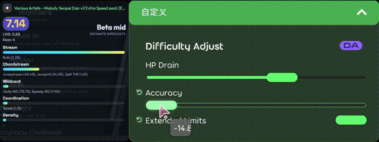
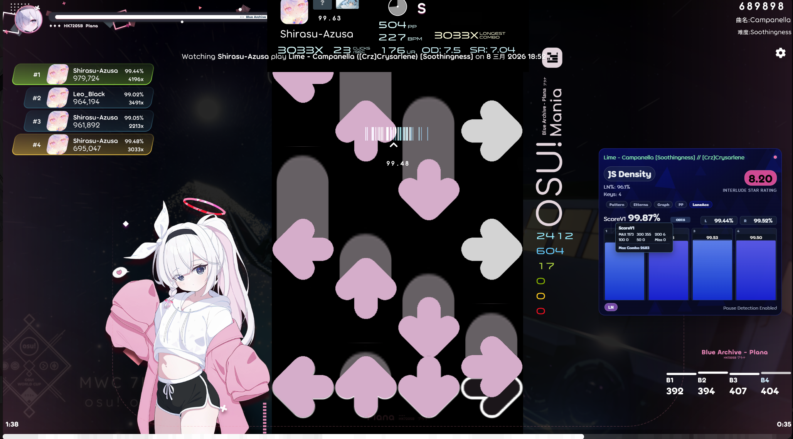
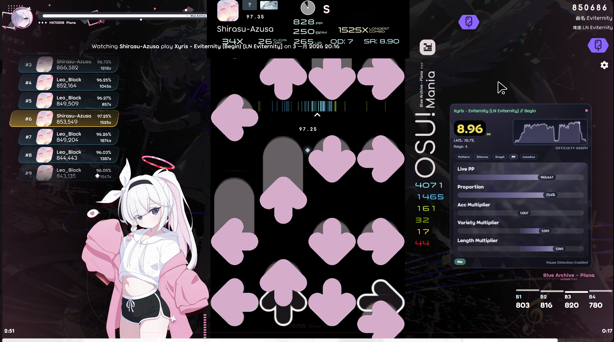
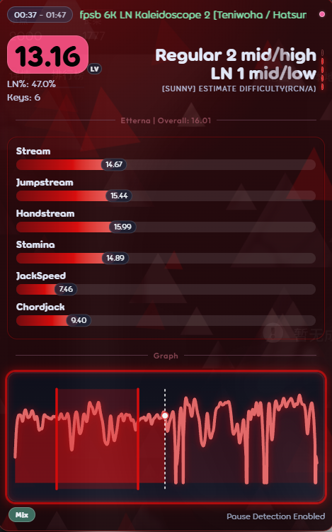
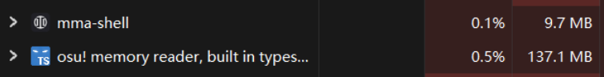

# osumania_map_analyser
**[English](README_EN.md) | 中文**
****
本仓库是一个纯AI打造的VSRG游戏内叠加界面，实时在 osu!mania(4/6/7K/Lazer/Stable)、Etterna、Malody V（及其编辑器）、Malody 4.3.7下，提供估算难度、RC/LN键型分析、MSD计算、难度分布、区间分析和分轨准确度等多种实用功能。

本项目同时支持在[tosu](https://tosu.app)中作为ppcounter使用。

功能展示

 

## 主要特性
- **基础功能**：在多种游戏选图过程中实时分析当前谱面的各项数据，包含多版本[Etterna](https://github.com/etternagame/etterna) MinaCalc、难度估计、难度图表等丰富内容。
- **多游戏支持**：同时支持Osu!Stable/Lazer、Etterna、Malody V及其编辑器、Malody 4.3.7。
- **多mod支持**：兼容上述游戏的多个mod，支持自定义倍速与判定修改。
- **区间分析**：双击难度分布图，拖动选中一段时间，单独计算某段的数据。
- **分轨准确度**：游玩过程中计算每个轨道的独立准确度，并实时转换到真ScoreV1。（仅限Lazer）
- **ReworkPP**：在游玩过程中实时计算 Sunny Rework PP，并展示其内部参数。
- **预设系统**：提供系统与自定义预设，一键应用/保存整套配置，支持自动跟随手动修改。
- **高度自定义**：提供丰富的自定义选项，满足不同玩家的需求。
- **轻量化**：使用桌面壳读取内存，无须额外启动 tosu，占用仅 ~10MB RAM，且不影响游戏性能。

## 快速开始

### 作为独立程序使用（推荐）
1. 前往[Release](https://github.com/LeoBlackMT/osumania_map_analyser/releases/latest)下载带shell的最新版本。
2. 将下载的文件解压到任意位置。
3. 如果你需要在 Etterna 或 Malody V 中使用，请一并在 Release 中下载`bridges.zip`，并解压到与shell同目录下，注意不要嵌套文件夹，确保正确放置。打开bridges目录，运行`install-bridge-zh.bat`（中文）或`install-bridge.bat`（英文）。对于Linux用户，请参照[本文档](docs/shell-guide.md)的“安装桥”章节手动安装 Etterna 与 Malody V 的桥文件。
4. 按下`Ctrl+Shift+S`打开设置页，在`Shell Configuration`中检查自动探测游戏目录结果是否正确，否则请填写需要使用的游戏目录，用于寻找谱面进行分析。
5. 完成后，按需重启应用，随后即可正常使用。其中 Malody V 编辑器需要手动点击`MMA Analyze`按钮进行分析。窗口的操作说明见下方。
6. 阅读[设置说明](docs/settings.md)、[预设系统教程](docs/presets-guide.md)和[桌面壳完整教程](docs/shell-guide.md)（含注意事项和常见问题），开始使用。

- 在OBS中捕获窗口时，如果捕获到黑屏，请在设置中使用 Windows 11 捕获方式。

| 操作 | 方法 |
| --- | --- |
| 拖动整个窗口 | 按住窗口顶部拖动条（发光细条，中间有 `⋮⋮` 标志）拖动。鼠标移上去会显示一圈描边，标出即将移动的整扇窗口范围 |
| 改变窗口大小 | 拖动窗口边缘（无边框，四周可拖）。看不到边界时把鼠标移向窗口边缘，贴近的边会发光 |
| 页面缩放 | 按住 `Ctrl` 滚动鼠标滚轮；或 `Ctrl +` / `Ctrl -`；`Ctrl 0` 复位 |
| 开关置顶（默认开） | 默认按 `Ctrl+Shift+T`（全局快捷键） |
| 开关点击穿透（默认关） | 默认按 `Ctrl+Shift+C`（全局快捷键） |
| 打开设置窗口 | 默认按 `Ctrl+Shift+S`（全局快捷键） |
| 关闭窗口 | 默认按 `Ctrl+Q`（全局快捷键） |
| 刷新卡片 | 选中窗口后按下 `F5` |

- 标注全局快捷键的操作在窗口失焦或点击穿透时同样有效。
- 卡片右上小圆点为当前激活的数据来源，包含：粉色-osu!(Stable/Lazer)、紫色-Etterna、亮青色-Malody 4.3.7、蓝色-Malody V、灰色空心-当前没有数据源。

### 在tosu中使用
1. 前往[Release](https://github.com/LeoBlackMT/osumania_map_analyser/releases/latest)下载不带shell的最新版本。
2. 将下载的文件解压到任意位置。
3. 将整个文件夹放置在 tosu 的 `static` 目录下，如果你没有修改 `Counters Directory` 设置项的话。注意不要嵌套文件夹，确保正确放置。
4. 启动 tosu，进入 dashborad，即可找到 "ManiaMapAnalyser" 插件，可以点击右侧`Settings`按钮进行相关设置。
5. 阅读[设置说明](docs/settings.md)和[预设系统教程](docs/presets-guide.md)，开始使用。游戏内界面以及OBS的使用方法见 tosu 相关文档。

## 注意事项
1. 本插件依赖于谱面数据的正确解析，某些特殊或非标准的谱面可能会导致分析结果不准确。
2. 本程序主要设计作为独立程序在 osu 中运行。在非 osu 来源或未使用桌面壳的前提下，部分功能可能会不可用或降级。
3. 从 Etterna 转换得到的谱面默认取 OD 9；Malody 4.3.7 与 Malody V 的转换 OD 由游戏内判定档（A~E或Pro）与谱面倍速（模组或Turbo Mode）共同决定。详见[docs/features/malody-od.md](docs/features/malody-od.md)。
4. 当Lazer更新，内存无法正常读取时，请尝试在设置中点击`壳设置 -> 内存偏移表管理 -> 偏移表操作 -> 检查 GitHub 远程更新`。若开发者尚未发布shell/偏移表更新时，点击旁边的`实时生成`可快速根据当前运行的Lazer进程尝试生成偏移表。使用时需要保持Lazer正在运行。你也可以通过`offsets/gen.exe`来生成。
5. 当无法启动桌面壳，日志中提示端口被占用时，请先用 `Get-NetTCPConnection -LocalPort 24061`（或 `netstat -ano | findstr :24061`）查占用进程 PID ，随后在任务管理器中关闭占用程序。所有的端口占用情况为：24061（壳页面）、24062（osu! 原生读取兼容端点）、17653（Malody V 选曲桥）；tosu 使用 24050。若 24061 被占用，壳无法启动。24062/17653 被占用时对应原生传输/桥功能会被降级。若修改了 tosu 端口，请在插件设置 `wsEndpoint` 中填写相同的 host:port。
6. 如果你无法使用 `Ctrl + Shift + S` 打开设置页，请检查是否有其他程序占用了该快捷键，或尝试打开 `mma-shell-config.json` 文件，手动修改 `hotkeys` 中的 `settings` 键值为其他组合键（如 `"settings": "Ctrl+Alt+S"`）。
7. 如果存在问题欢迎提交issue。我们也欢迎任何人在遵守[CONTRIBUTING.md](CONTRIBUTING.md)的前提下提交PR！

## 设置说明
注意：推荐直接使用默认设置开始体验，或选择一个合适的预设，之后再根据个人喜好进行调整。  
详细设置说明见 [docs/settings.md](docs/settings.md) 。  
预设系统教程见 [docs/presets-guide.md](docs/presets-guide.md)。  
桌面壳教程见 [docs/shell-guide.md](docs/shell-guide.md)。

## 难度估计算法说明

- 难度估计算法虽然经过调整，但仍然可能存在不准确的情况，请仅将其作为参考。对于4K，一般情况下在 Reform Beta 开始比较准确，整体误差不超过半个段位，低难相对没那么准确；在Minijack、Stamina和Anchor等键型中，估计结果可能会有较大的偏差。对于6K和7K，整体表现相对一般。建议玩家结合自己的实际游玩体验进行判断，不要过于依赖估计结果，将算法视为一个真正的玩家给出的参考结果。

### 基准测试
- 基准测试已迁移至独立仓库 [VSRG-DanEstimation-Benchmark](https://github.com/LeoBlackMT/VSRG-DanEstimation-Benchmark)，测试结果可以在[此处](https://benchmark.leoblack.top/)查看。测试涵盖了多个算法在不同类型谱面上的表现，帮助玩家选择适合自己的算法。
- 需要注意的是，虽然基准测试提供了算法表现的参考，但实际使用中可能会受到谱面特征、mod组合等多种因素的影响，建议玩家结合自己的游玩体验进行判断。
- 受限于人工标注误差以及玩家个人差异，目前在1300+样本量下的难度估计准确度已经接近极限。我们添加了对算法的反馈功能，欢迎广大玩家在游玩时对其进行反馈，这有助于我们寻找偏离较大的谱面并针对优化，谢谢！
- 你可以在[此处](https://github.com/LeoBlackMT/VSRG-DanEstimation-Benchmark/tree/main/samples/samples.7z)下载用于基准测试的谱面数据，但是请注意阅读免责声明，合理使用这些数据。

### 特色算法
- Sunny 是一个星数直接映射到难度的表。请注意与 SunnyRework 进行区分，后者只是星数与PP计算。本表格通过计算对应段位的星数，直接划分出多个映射区间，详细的表格请查阅 `js/estimator/intervals`。
- Roxy 是一个 4K RC 元结构估算器，聚焦高难区间（Alpha 至 Emik Zeta high）。其核心分为两层：第一层对谱面进行 7 个方面结构分析，产出结构化数值难度；第二层通过 Ridge 线性元模型融合 Azusa/Daniel 的参考预测，并在最终输出上与 Azusa 预测按 0.4/0.6 加权平均，输出最终难度。元模型按段位 0.5 序数刻度校准，使结果更贴近段位判定。如有需要，请前往[此处](docs/roxy_algorithm.md)(英文)查看算法文档。
- Azusa 算法在谱面本身的基础上，融合了Daniel和Sunny Rework的结果，并针对4K RC谱面进行了特定的调整。如有需要，请前往[此处](docs/azusa_algorithm.md)(英文)查看算法文档。
- Polaris 是一个表修正估算器。以 Sunny 为基线，修正“星数 → 段位”映射的系统性偏差。覆盖 7K 的 RC 与 LN 两侧；如有需要，请前往[此处](docs/polaris_algorithm.md)(英文)查看算法文档。
- Mixed 是一个路由器。通过智能识别谱面信息来自动路由到内置最佳算法，在必要情况下会进行修正和融合。拥有全局最优准确度。

### 第三方算法
- [Daniel](https://thebagelofman.github.io/Daniel/): SunnyRework 的改进版本。仅支持 4K RC。
- [Companella](https://github.com/Leinadix/companella): 基于 Etterna MinaCalc 的 4K 段位 onnx 估算模型。
- [XDC1](https://github.com/TheBagelOfMan/xdc1): 构建 4K 单手模型，综合手指、手腕与抖动三种维度并计入LN代价与体力消耗估计难度。支持 4K RC/LN（Alpha 至 Theta）。
- [Proj7k](https://github.com/ka1z07/proj7k): proj7k 7K 难度引擎的移植。按手指建模负荷，用阈值求解得到整首难度，再按 JinJin Dan 给出标签；仅支持 7K，其他键数回退 Sunny。算法文档见[此处](docs/proj7k_algorithm.md)(英文)。

## 隐私
- 本插件默认开启匿名使用统计，用于统计活跃用户数、在线分布与使用行为。上报内容不含用户名、玩家 id、分数、谱面标识（标题/md5）、IP 地址等任何个人信息，数据仅用于生成聚合统计。如不希望上报，可在设置 → Network 分组中关闭 "Anonymous Usage Statistics"。
- 本插件默认开启估计算法反馈，在玩家游玩结束后会在卡片下方提示玩家对本次估计算法进行反馈，用于收集准确度信息、偏差较大谱面以及整体估计情况。上报内容只包含本轮游玩的谱面bid、模组和算法输出等必要信息，不包含个人信息。数据仅用于改进估计算法。如不希望上报，可在设置 → Network 分组中关闭 "Difficulty Feedback"。
- 两者的数据透明公开，看板见：https://mma-stats.leoblack.top/

## 贡献指南
详见 [CONTRIBUTING.md](CONTRIBUTING.md)。

## 参考内容
- [tosu](https://tosu.app): 本插件的运行环境和基础框架。
- [Etterna](https://github.com/etternagame/etterna): 使用了Etterna的MinaCalc进行难度估计和MSD计算。
- [Sunny Rework](https://github.com/sunnyxxy/Star-Rating-Rebirth): 使用了Sunny Rework的算法计算星数，是大部分算法的基础。
- [Interlude](https://github.com/YAVSRG/YAVSRG): 使用了Interlude的RC键型分析算法并在基础上新增LN检测算法。
- [Daniel](https://thebagelofman.github.io/Daniel/): 使用了Daniel的算法进行难度估计。
- [Companella](https://github.com/Leinadix/companella): 使用了Companella的算法进行难度估计。
- [XDC1](https://github.com/TheBagelOfMan/xdc1): 使用了 XDC1 的算法进行 4K 难度估计。
- [DanielEtterna](https://github.com/JoseMGS3/DanielEtterna)：参考了其获取Etterna数据的方法。

## 贡献者/致谢
- [inuiyumegan](https://github.com/inuiyumegan): 提供了大量谱面数据用于算法调试和Benchmark。
- [greycsont](https://github.com/greycsont): 提供了部分功能。
- [ZHAO20060708](https://github.com/ZHAO20060708): 提供了精美的Lazer主题和Full模式（现已更新为Combined模式）。
- [SST-03](https://github.com/SST-03) & [AkutaZehy](https://github.com/AkutaZehy): 提供了改进的 Sunny LN 算法。
- [未来lk](https://space.bilibili.com/419035379): 赞助了300M Token。
- [Entitley](https://space.bilibili.com/3546767926758173)于[Malody V小卡片](https://www.bilibili.com/video/BV1S6et6EEND/)视频下方发表的[评论](https://www.bilibili.com/video/BV1S6et6EEND/#reply314476062705)：提供了 MalodyV 支持的灵感来源和 BepInEx 插件部分源码。
- [aleju03](https://github.com/aleju03)：通过其项目 [mania-hub](https://github.com/aleju03/mania-hub) 提供了大规模真实游玩行为数据集（约484万次4K/7K游玩），用于难度判定与玩家实际成绩的对照分析，是 Polaris 的数据基础。

---------
本页自2026/6/21起累计访问量，感谢大家的支持！

