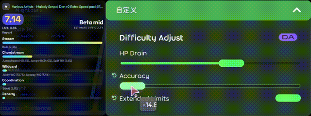
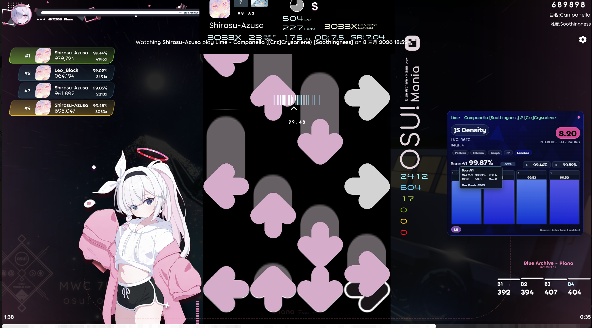
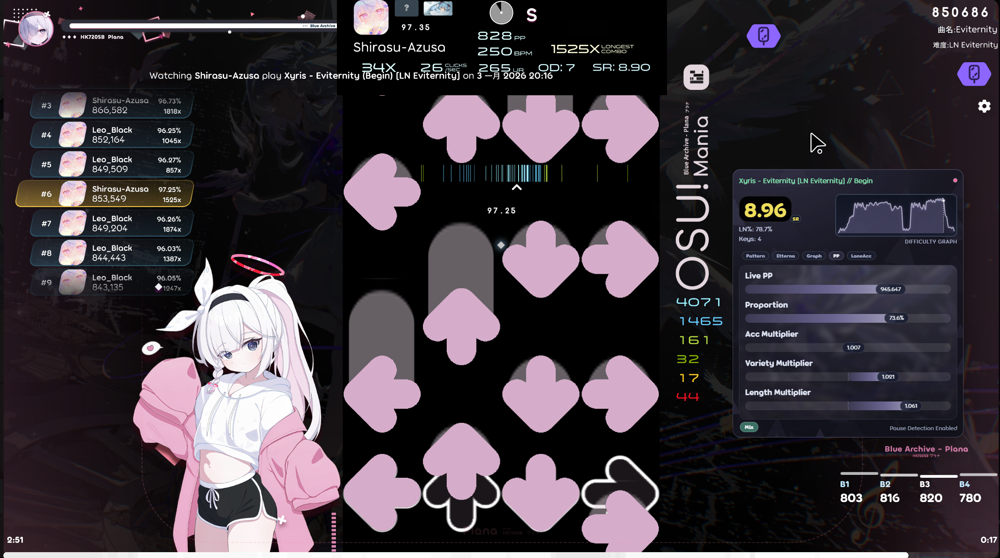
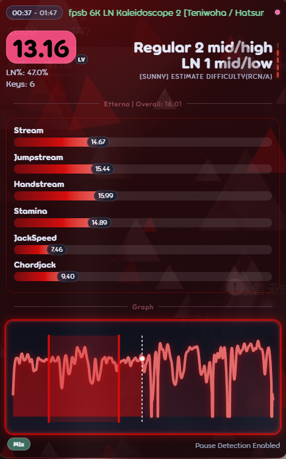
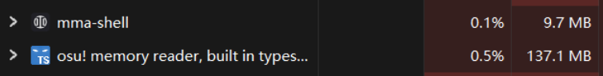

# osumania_map_analyser
**English | [中文](README.md)**

> **Translation Note**: This document was translated from Chinese to English with the assistance of an AI language model. While efforts have been made to ensure accuracy, please refer to the original Chinese version if any ambiguity arises.
****
This repository is an entirely AI-crafted VSRG in-game overlay, providing real-time support across osu!mania (4/6/7K/Lazer/Stable), Etterna, Malody V (and its editor), and Malody 4.3.7. It offers estimated difficulty, RC/LN pattern analysis, MSD calculation, difficulty distribution, section analysis, lane accuracy, and other practical features.

This project also supports running inside [tosu](https://tosu.app) as a ppcounter.

Features

 

## Key Features
- **Core Capabilities**: Real-time analysis of beatmap metrics during song selection across multiple games, featuring multi-version [Etterna](https://github.com/etternagame/etterna) MinaCalc, difficulty estimation, difficulty graphs, and more.
- **Multi-game Support**: Supports osu!stable / lazer, Etterna, Malody V and its editor, and Malody 4.3.7 simultaneously.
- **Multi-mod Support**: Compatible with multiple mods in the above games, supporting custom speed rates and judgment/OD adjustments.
- **Section Analysis**: Double-click the difficulty distribution graph and drag to select a time slice to calculate data specifically for that section.
- **Lane Accuracy**: Calculates independent accuracy for each lane during gameplay and converts in real time to true ScoreV1 (Lazer / Stable; Stable lanes use the game's per-note judgments).
- **ReworkPP**: Computes Sunny Rework PP in real time during gameplay and displays its internal parameters.
- **Preset System**: Provides system and custom presets to apply or save the full configuration in one click, supporting automatic following of manual changes.
- **Highly Customizable**: Offers rich customization options to meet different player preferences.
- **Lightweight**: Uses the desktop shell to read memory without launching tosu, consuming only ~10MB RAM with no impact on game performance.

## Quick Start

### As a Standalone Application (Recommended)
1. Go to [Releases](https://github.com/LeoBlackMT/osumania_map_analyser/releases/latest) and download the latest version with the shell included.
2. Extract the downloaded package to any folder.
3. If you need to use it with Etterna or Malody V, also download `bridges.zip` from Releases and extract it into the same directory as the shell (ensure no nested folders). Open the `bridges` directory and run `install-bridge-zh.bat` (Chinese) or `install-bridge.bat` (English). For Linux users, refer to the "Bridges" section of [docs/shell-guide.md](docs/shell-guide.md) to install bridge files manually.
4. Press `Ctrl+Shift+S` to open the settings window. Under `Shell Configuration`, verify that the auto-detected game paths are correct; otherwise, enter the game directories you use so beatmaps can be located for analysis.
5. Once configured, restart the application if needed, and it will be ready to use. Note that the Malody V editor requires clicking the `MMA Analyze` button manually to analyze. Window controls are described below.
6. Read the [Settings Guide](docs/settings.md), [Presets Guide](docs/presets-guide.md), and [Desktop Shell Guide](docs/shell-guide.md) (including notes and troubleshooting) to get started.

- When capturing the window in OBS, if the capture is black, use the Windows 11 capture method in the settings.

| Action | Method |
| --- | --- |
| Drag window | Click and drag the top drag bar (the glowing bar with the `⋮⋮` mark). Hovering displays an outline showing the full window boundary |
| Resize window | Drag any window edge (borderless, draggable on all sides). Move cursor near an edge to make it glow |
| Page zoom | Hold `Ctrl` and scroll mouse wheel; or `Ctrl +` / `Ctrl -`; `Ctrl 0` to reset |
| Toggle always-on-top (default on) | `Ctrl+Shift+T` by default (global shortcut) |
| Toggle click-through (default off) | `Ctrl+Shift+C` by default (global shortcut) |
| Open settings window | `Ctrl+Shift+S` by default (global shortcut) |
| Close window | `Ctrl+Q` by default (global shortcut) |
| Refresh card | Focus the window and press `F5` |

- Global shortcuts remain active even when the window is unfocused or click-through is enabled.
- The small dot at the top-right of the card indicates the currently active data source: pink for osu! (Stable/Lazer), purple for Etterna, bright cyan for Malody 4.3.7, blue for Malody V, and hollow grey when there is no active data source.

### In tosu
1. Go to [Releases](https://github.com/LeoBlackMT/osumania_map_analyser/releases/latest) and download the latest version without the shell.
2. Extract the downloaded package to any folder.
3. Place the entire folder directly inside tosu's `static` directory, unless you have modified the `Counters Directory` setting. Ensure the folder is not nested.
4. Start tosu and open the dashboard. Locate the "ManiaMapAnalyser" plugin and click `Settings` on the right to configure it.
5. Read the [Settings Guide](docs/settings.md) and [Presets Guide](docs/presets-guide.md) to get started. Refer to tosu documentation for in-game overlays and OBS setup.

## Notes
1. This plugin relies on the correct parsing of beatmap data. Certain special or non-standard beatmaps may cause inaccurate analysis results.
2. This program is primarily designed to run as a standalone application with osu!. Without an osu! source or the desktop shell, some features may be unavailable or degraded.
3. Beatmaps converted from Etterna use OD 9 by default; the conversion OD for Malody 4.3.7 and Malody V is determined by the in-game judge level (A–E or Pro) and the chart rate (mods or Turbo Mode). See [docs/features/malody-od.md](docs/features/malody-od.md).
4. When osu!(lazer) updates and memory reading fails before a new shell or offset table is released, click Memory Offsets Management -> Live Generator in settings to quickly generate an offset table from the running lazer process. Lazer must remain running during generation. You can also run `offsets/gen.exe` directly.
5. If the desktop shell cannot start and the log says the port is occupied, use `Get-NetTCPConnection -LocalPort 24061` (or `netstat -ano | findstr :24061`) to find the PID, then close that program in Task Manager. All port assignments are: 24061 (shell page), 24062 (osu! native-read compatibility endpoint), and 17653 (Malody V selection bridge); tosu uses 24050. If 24061 is occupied, the shell cannot start. If 24062/17653 is occupied, the corresponding native transport/bridge degrades. If you change tosu's port, set the same host:port in the plugin's `wsEndpoint` setting.
6. If you cannot open the settings page with `Ctrl + Shift + S`, check if another program is using that shortcut, or manually edit the `mma-shell-config.json` file to change the `settings` key in `hotkeys` to a different combination (e.g. `"settings": "Ctrl+Alt+S"`).
7. Feel free to submit an issue if you encounter problems. We also welcome pull requests that follow [CONTRIBUTING.md](CONTRIBUTING.md)!

## Settings Guide
Note: It is recommended to start with default settings or select a suitable preset, then fine-tune according to personal preference.  
Detailed settings documentation: [docs/settings.md](docs/settings.md).  
Preset system guide: [docs/presets-guide.md](docs/presets-guide.md).  
Desktop shell guide: [docs/shell-guide.md](docs/shell-guide.md).

## Difficulty Estimation Algorithms

- Although the difficulty estimation algorithms have been tuned, they may still be inaccurate; use them for reference only. For 4K, results are generally more accurate from Reform Beta upward, with an overall error of no more than half a Dan; lower difficulties are less accurate. Patterns such as Minijack, Stamina, and Anchor may show larger deviations. For 6K and 7K, overall performance is moderate. Players should combine estimates with their own gameplay experience and not rely on them excessively; treat the algorithm as another player's reference.

### Benchmark
- Benchmarks have been migrated to the standalone repository [VSRG-DanEstimation-Benchmark](https://github.com/LeoBlackMT/VSRG-DanEstimation-Benchmark), and results can be viewed [here](https://benchmark.leoblack.top/). Tests cover multiple algorithms across various beatmap categories to help players find what fits them best.
- Please note that while benchmarks provide reference performance, real-world results can vary with beatmap patterns, mod combinations, and other factors. Combine benchmark results with your own play experience.
- Due to manual annotation error and individual player differences, estimation accuracy on the 1,300+ sample set has approached its practical limit. We have added a feedback feature for the estimators: players are welcome to rate estimates after a play, which helps us find maps that deviate most and improve them. Thank you!
- You can download benchmark beatmap samples [here](https://github.com/LeoBlackMT/VSRG-DanEstimation-Benchmark/tree/main/samples/samples.7z). Please read the disclaimer and use the data responsibly.

### Featured Algorithms
- Sunny is a direct star-to-difficulty mapping table. Note that it is distinct from SunnyRework, which only handles star rating and PP calculation. The table divides star ratings into multiple mapping intervals by Dan tier; see `js/estimator/intervals` for details.
- Roxy is a 4K RC meta-structural estimator focused on high-difficulty ranges (Alpha to Emik Zeta high). Its core operates in two layers: structural analysis across 7 aspects yielding structured numeric difficulty, followed by a Ridge linear meta-model blending Azusa and Daniel reference predictions, weighted 0.4/0.6 with Azusa on the final output to reduce variance. The meta-model is calibrated to 0.5 Dan ordinal scale. See the algorithm documentation [here](docs/roxy_algorithm.md).
- Azusa integrates Daniel and Sunny Rework outputs based on beatmap data, with specialized tuning for 4K RC beatmaps. See the algorithm documentation [here](docs/azusa_algorithm.md).
- Polaris is a table-mapping correction estimator for Sunny. It covers both the RC and LN sides on 7K; other key counts automatically fall back to Sunny. See the algorithm documentation [here](docs/polaris_algorithm.md).
- Mixed is a router. It intelligently identifies beatmap characteristics and routes to the best built-in algorithm, applying corrections or blending where needed. It has the best overall accuracy.

### Third-party Algorithms
- [Daniel](https://thebagelofman.github.io/Daniel/): An improved version of SunnyRework. Supports 4K RC only.
- [Companella](https://github.com/Leinadix/companella): A 4K Dan ONNX estimation model based on Etterna MinaCalc.
- [XDC1](https://github.com/TheBagelOfMan/xdc1): A from-scratch 4K one-hand model that blends finger, wrist, and jitter techniques with hold costs and stamina drain; supports 4K RC/LN (Alpha to Theta).
- [Proj7k](https://github.com/ka1z07/proj7k): A port of the proj7k 7K difficulty engine. It models load per finger, solves a threshold for the chart's difficulty, and labels it on the JinJin Dan ladder; 7K only, other key counts fall back to Sunny.

## Privacy
- Anonymous usage statistics are enabled by default to track active users, online distribution, and usage patterns. Telemetry contains no usernames, player IDs, scores, beatmap identities (titles/MD5), or IP addresses; data is strictly used for aggregated statistics. To opt out, disable "Anonymous Usage Statistics" under Settings → Network.
- Estimator difficulty feedback is enabled by default: after a play, the card asks you to rate this play's estimate. It collects accuracy information, maps with large deviations, and overall estimator behavior. Only the beatmap ID, mods, and estimator outputs of this play are sent — no personal information — and the data is used only to improve the estimators. To opt out, disable "Difficulty Feedback" under Settings → Network.
- Both datasets are public on the dashboard: https://mma-stats.leoblack.top/

## Contributing
See [CONTRIBUTING.md](CONTRIBUTING.md).

## References
- [tosu](https://tosu.app): Runtime environment and base framework.
- [Etterna](https://github.com/etternagame/etterna): MinaCalc used for difficulty estimation and MSD calculation.
- [Sunny Rework](https://github.com/sunnyxxy/Star-Rating-Rebirth): Used the Sunny Rework algorithm for star rating calculations, which is the foundation of most algorithms.
- [Interlude](https://github.com/YAVSRG/YAVSRG): RC pattern analysis algorithm, with added LN detection logic.
- [Daniel](https://thebagelofman.github.io/Daniel/): Algorithm used for difficulty estimation.
- [Companella](https://github.com/Leinadix/companella): Algorithm used for difficulty estimation.
- [XDC1](https://github.com/TheBagelOfMan/xdc1): Algorithm used for 4K difficulty estimation.
- [DanielEtterna](https://github.com/JoseMGS3/DanielEtterna): Reference for Etterna data retrieval methods.

## Contributors / Acknowledgements
- [inuiyumegan](https://github.com/inuiyumegan): Provided extensive beatmap data for debugging and benchmarking.
- [greycsont](https://github.com/greycsont): Contributed multiple features.
- [ZHAO20060708](https://github.com/ZHAO20060708): Provided the polished Lazer theme and Full mode design (now updated to Combined mode).
- [SST-03](https://github.com/SST-03) & [AkutaZehy](https://github.com/AkutaZehy): Provided the improved Sunny LN algorithm.
- [未来lk](https://space.bilibili.com/419035379): Sponsored 300M tokens.
- [Entitley](https://space.bilibili.com/3546767926758173): Provided the inspiration for Malody V support and partial BepInEx plugin source code in the [comment](https://www.bilibili.com/video/BV1S6et6EEND/#reply314476062705) on the [Malody V card](https://www.bilibili.com/video/BV1S6et6EEND/) video.
- [aleju03](https://github.com/aleju03): Provided a large-scale real-play behavioural dataset (roughly 4.84 million 4K/7K plays) for free through the [mania-hub](https://github.com/aleju03/mania-hub) project, used to compare dan verdicts against how players actually score. This is the data foundation for Polaris.

---------
Total page views since June 21, 2026. Thanks for your support!

