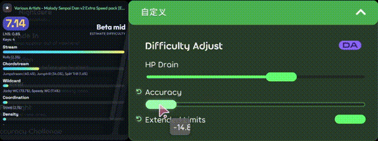

# osumania_map_analyser
**English | [中文](README.md)**

> **Translation Note**: This document was translated from Chinese to English with the assistance of an AI language model. While efforts have been made to ensure accuracy, please refer to the original Chinese version if any ambiguity arises.
****
This repository is an entirely AI-crafted VSRG in-game overlay, providing real-time support across osu!mania (4/6/7K/Lazer/Stable), Etterna, Malody V, and Malody 4.3.7. It offers estimated difficulty, RC/LN pattern analysis, multiple MSD version calculation, difficulty distribution, and other practical features.

This project also supports running inside [tosu](https://tosu.app) as a ppcounter.

Screenshots

## Key Features
- **Real-time Analysis**: Analyzes various data of the current beatmap in real time during gameplay or song selection.
- **Multi-game Support**: Supports osu!stable / lazer, Etterna, Malody V and its editor, and Malody 4.3.7 simultaneously.
- **Multi-mod Support**: Compatible with multiple mods in the above games, supporting custom speed rates and judgment/OD adjustments.
- **Customizable MSD Versions**: Allows users to select different versions of [Etterna](https://github.com/etternagame/etterna) MinaCalc for calculation while surpassing Etterna's official 40 MSD cap.
- **Difficulty Estimation**: Estimates difficulty based on beatmap data and provides detailed analysis results with multiple difficulty estimation algorithms. Compatible with 4/6/7K LN and RC Dans.
- **Graph Visualization**: Provides difficulty variation graphs to help players better understand beatmap difficulty distributions.
- **Pattern Analysis**: Analyzes RC/LN pattern distribution to help players understand beatmap structures.
- **Rework PP**: Provides the Sunny Rework PP panel, displaying detailed metrics that update in real time.
- **Preset System**: Provides system and custom presets to apply or save the full configuration in one click, supporting automatic following of manual changes.
- **Highly Customizable**: Offers rich customization options to meet different player preferences.

## Quick Start

### As a Standalone Application (Recommended)
1. Go to [Releases](https://github.com/LeoBlackMT/osumania_map_analyser/releases/latest) and download the latest version with the shell included.
2. Extract the downloaded package to any folder.
3. If you need to use it with Etterna or Malody V, run `bridges/install-bridge-zh.bat` (Chinese) or `bridges/install-bridge.bat` (English). For Linux users, refer to the "Bridges" section of [docs/shell-guide.md](docs/shell-guide.md) to install the bridge files manually.
4. Press `Ctrl+Shift+S` to open the settings window. Under `Shell Configuration`, verify that the auto-detected game paths are correct; otherwise, enter the game directories you use so beatmaps can be located for analysis.
5. Once configured, restart the application if needed, and it will be ready to use. Note that the Malody V editor requires clicking the `MMA Analyze` button manually to analyze. Window controls are described below.
6. Read the [Settings Guide](docs/settings.md), [Presets Guide](docs/presets-guide.md), and [Desktop Shell Guide](docs/shell-guide.md) (including notes and troubleshooting) to get started.

| Action | Method |
| --- | --- |
| Drag window | Click and drag the top drag bar (the glowing bar with the `⋮⋮` mark). Hovering displays an outline showing the full window boundary |
| Resize window | Drag any window edge (borderless, draggable on all sides). Move cursor near an edge to make it glow |
| Page zoom | Hold `Ctrl` and scroll mouse wheel; or `Ctrl +` / `Ctrl -`; `Ctrl 0` to reset |
| Toggle always-on-top (default on) | `Ctrl+Shift+T` by default (global shortcut) |
| Toggle click-through (default off) | `Ctrl+Shift+C` by default (global shortcut) |
| Open settings window | `Ctrl+Shift+S` by default (global shortcut) |
| Close window | `Ctrl+Q` by default (global shortcut) |
| Refresh card | Focus the window and press `F5`; press `Ctrl+F5` to refresh cache |

Global shortcuts remain active even when the window is unfocused or click-through is enabled.

### In tosu
1. Go to [Releases](https://github.com/LeoBlackMT/osumania_map_analyser/releases/latest) and download the latest version without the shell.
2. Extract the downloaded package to any folder.
3. Place the entire folder directly inside tosu's `static` directory, unless you have modified the `Counters Directory` setting. Ensure the folder is not nested.
4. Start tosu and open the dashboard. Locate the "ManiaMapAnalyser" plugin and click `Settings` on the right to configure it.
5. Read the [Settings Guide](docs/settings.md) and [Presets Guide](docs/presets-guide.md) to get started. Refer to tosu documentation for in-game overlays and OBS setup.

## Notes
1. This plugin relies on the correct parsing of beatmap data. Certain special or non-standard beatmaps may cause inaccurate analysis results.
2. Although the difficulty estimation algorithms have been tuned, inaccuracies may still occur; use them for reference only. For 4K, high difficulties are generally more accurate with an error usually within half a Dan, while lower difficulties may be less accurate; patterns like Minijack, Stamina, and Anchor may show larger deviations. For 6K and 7K, overall performance is moderate. Players should combine estimates with their actual gameplay experience and not overly rely on them, viewing the algorithm as another player's estimation.
3. Performance may be affected by beatmap complexity and enabled features; lag or delay may occur in some scenarios. Adjust settings according to your system for a smoother experience.
4. When osu!(lazer) updates and memory reading fails before a new shell or offset table is released, click Memory Offsets Management -> Live Generator in settings to quickly generate an offset table from the running lazer process. Lazer must remain running during generation. You can also run `offsets/gen.exe` directly.
5. Port occupied: It uses 24061 (shell page), 24062 (osu! native-read compatibility origin), and 17653 (Malody V selection bridge); tosu uses 24050. If 24061 is occupied by another program, the shell reports the conflict and cannot start; find the PID with `Get-NetTCPConnection -LocalPort 24061` (or `netstat -ano | findstr :24061`) and close that program. If 24062/17653 is occupied, the corresponding native transport/bridge degrades while other features keep working. If you change tosu's port, set the same host:port in the plugin's `wsEndpoint` setting.
6. If you cannot open the settings page with `Ctrl + Shift + S`, check if another program is using that shortcut, or manually edit the `mma-shell-config.json` file to change the `openSettings` key in `hotkeys` to a different combination.
7. Feel free to submit an issue if you encounter problems.

## Estimator Algorithm Benchmark
- Benchmarks have been migrated to the standalone repository [VSRG-DanEstimation-Benchmark](https://github.com/LeoBlackMT/VSRG-DanEstimation-Benchmark), and results can be viewed [here](https://benchmark.leoblack.top/). Tests cover multiple algorithms across various beatmap categories to help players find what fits them best.
- Please note that while benchmarks provide reference performance, real-world results can vary with beatmap patterns, mod combinations, and other factors. Combine benchmark results with your own play experience.
- Due to manual annotation error and individual player differences, estimation accuracy on the 700+ sample set has approached its practical limit. We have added a feedback feature for the estimators: players are welcome to rate estimates after a play, which helps us find maps that deviate most and improve them. Thank you!
- You can download benchmark beatmap samples [here](https://github.com/LeoBlackMT/VSRG-DanEstimation-Benchmark/tree/main/samples/samples.7z). Please read the disclaimer and use the data responsibly.

## Privacy / Anonymous Usage Statistics
- Anonymous usage statistics are enabled by default to track active users, online distribution, and usage patterns. Telemetry contains no usernames, player IDs, scores, beatmap identities (titles/MD5), or IP addresses; data is strictly used for aggregated statistics. To opt out, disable "Anonymous Usage Statistics" under Settings → Network.
- Estimator difficulty feedback is enabled by default: after a play, the card asks you to rate this play's estimate. It collects accuracy information, maps with large deviations, and overall estimator behavior. Only the beatmap ID, mods, and estimator outputs of this play are sent — no personal information — and the data is used only to improve the estimators. To opt out, disable "Difficulty Feedback" under Settings → Network.
- Both datasets are public on the dashboard: https://mma-stats.leoblack.top/

## Settings Guide
Note: It is recommended to start with default settings or select a suitable preset, then fine-tune according to personal preference.  
Detailed settings documentation: [docs/settings.md](docs/settings.md).  
Preset system guide: [docs/presets-guide.md](docs/presets-guide.md).  
Desktop shell guide: [docs/shell-guide.md](docs/shell-guide.md).

## Algorithm Documentation
- Roxy is a 4K RC meta-structural estimator focused on high-difficulty ranges (numeric difficulty 11~17, Alpha to Emik Zeta high). Its core operates in two layers: structural analysis across 7 aspects yielding structured numeric difficulty, followed by a Ridge linear meta-model blending Azusa and Daniel reference predictions, weighted 0.4/0.6 with Azusa on the final output to reduce variance. The meta-model is calibrated to 0.5 Dan ordinal scale. See the algorithm documentation [here](docs/roxy_algorithm.md).
- Azusa integrates Daniel and Sunny Rework outputs based on beatmap data, with specialized tuning for 4K RC beatmaps. See the algorithm documentation [here](docs/azusa_algorithm.md).
- Polaris is a table-calibration estimator. It builds on Sunny and corrects systematic star-to-dan mapping deviations with real play data (speed-mod response, LN-heavy charts, level shape). It covers both the RC and LN sides on 7K; other key counts (including 4K/6K) fall back to Sunny. See the algorithm documentation [here](docs/polaris_algorithm.md).

## Contributing
See [CONTRIBUTING.md](CONTRIBUTING.md).

## References
- [tosu](https://tosu.app): Runtime environment and base framework.
- [Etterna](https://github.com/etternagame/etterna): MinaCalc used for difficulty estimation and MSD calculation.
- [Sunny Rework](https://github.com/sunnyxxy/Star-Rating-Rebirth): Algorithm used for difficulty estimation.
- [Interlude](https://github.com/YAVSRG/YAVSRG): RC pattern analysis algorithm, with added LN detection logic.
- [Daniel](https://thebagelofman.github.io/Daniel/): Algorithm used for difficulty estimation.
- [Companella](https://github.com/Leinadix/companella): Algorithm used for difficulty estimation.
- [DanielEtterna](https://github.com/JoseMGS3/DanielEtterna): Reference for Etterna data retrieval methods.

## Contributors / Acknowledgements
- [inuiyumegan](https://github.com/inuiyumegan): Provided extensive beatmap data for debugging and benchmarking.
- [greycsont](https://github.com/greycsont): Contributed multiple features.
- [ZHAO20060708](https://github.com/ZHAO20060708): Provided the polished Lazer theme and Full mode design.
- [SST-03](https://github.com/SST-03) & [AkutaZehy](https://github.com/AkutaZehy): Provided the improved Sunny LN algorithm.
- [未来lk](https://space.bilibili.com/419035379): Sponsored 300M tokens.
- [Entitley](https://space.bilibili.com/3546767926758173): Provided inspiration and partial BepInEx plugin source code in the [comment](https://www.bilibili.com/video/BV1S6et6EEND/#reply314476062705) on the [Malody V card](https://www.bilibili.com/video/BV1S6et6EEND/) video.
- [aleju03](https://github.com/aleju03): Provided a large-scale real-play behavioural dataset (4.84M plays, 4K/7K) for free through the [mania-hub](https://github.com/aleju03/mania-hub) project, used to compare dan verdicts against how players actually score. This is the data foundation for Polaris.

---------
Total page views since June 21, 2026. Thanks for your support!

